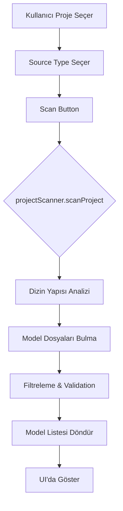
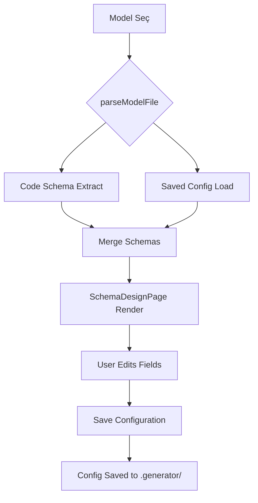
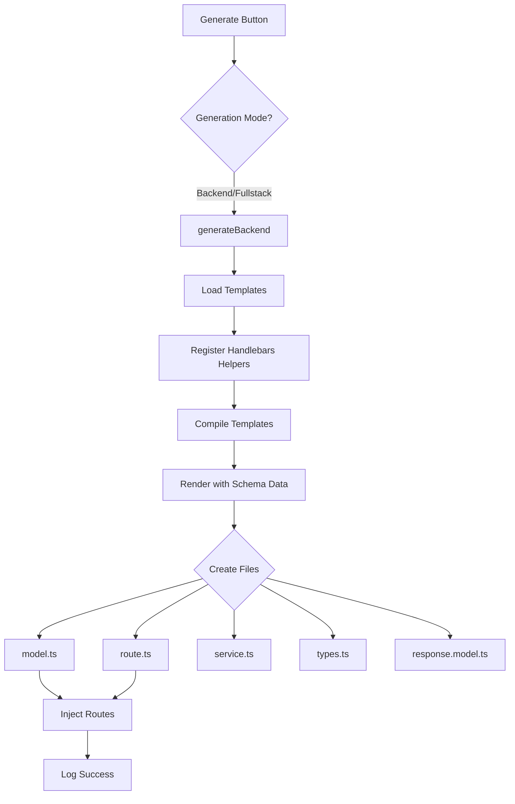
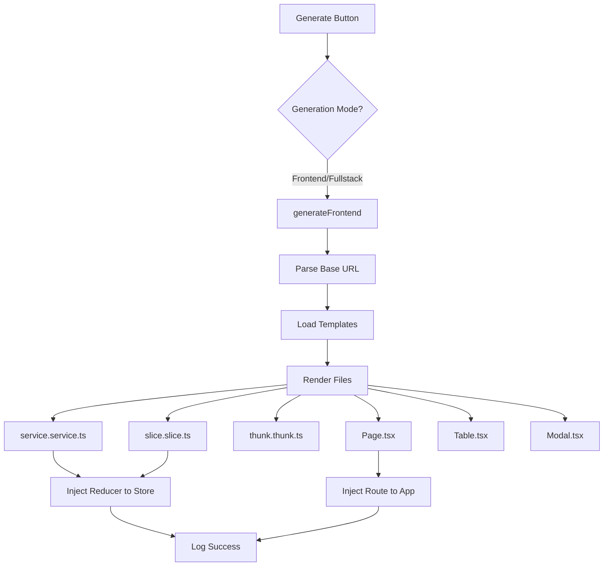
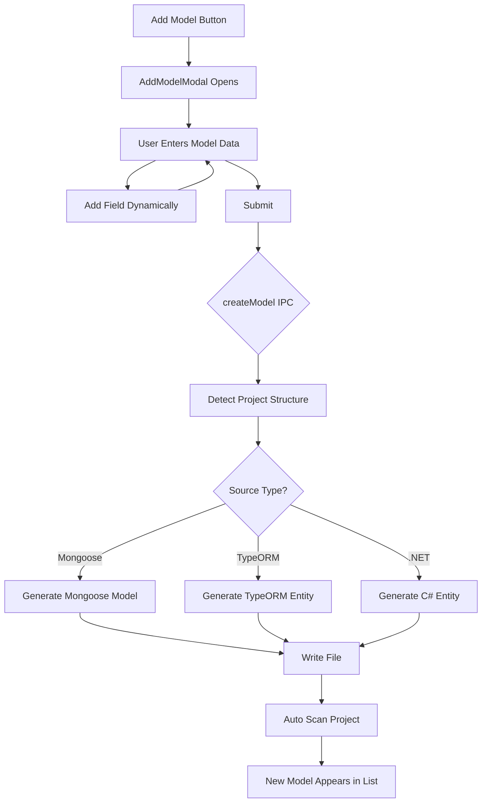

# Universal Code Generator - Detaylı Proje Analizi

**Analiz Tarihi:** 25 Aralık 2025  
**Proje Versiyonu:** 1.0.0  
**Analiz Eden:** AI Code Assistant

---

## 📋 İçindekiler

1. [Proje Genel Bakış](#1-proje-genel-bakış)
2. [Teknik Mimari](#2-teknik-mimari)
3. [Ana Bileşenler Analizi](#3-ana-bileşenler-analizi)
4. [İş Akışı ve Süreçler](#4-iş-akışı-ve-süreçler)
5. [Desteklenen Stack'ler](#5-desteklenen-stackler)
6. [Güçlü Yönler](#6-güçlü-yönler)
7. [İyileştirme Alanları](#7-iyileştirme-alanları)
8. [Genişletilebilirlik](#8-genişletilebilirlik)

---

## 1. Proje Genel Bakış

### 1.1 Amaç ve Hedef

**Universal Code Generator**, backend ve frontend kod dosyalarını otomatik olarak üreten bir masaüstü uygulamasıdır. Proje, geliştiricilerin tekrarlayan CRUD (Create, Read, Update, Delete) operasyonlarını hızlı ve standart bir şekilde oluşturmasını sağlar.

### 1.2 Temel İşlevsellik

- **Model Parsing:** Mevcut model dosyalarını okuyup analiz etme
- **Schema Design:** UI üzerinden field'ların görünüm ve davranış yapılandırması
- **Code Generation:** Backend (model, route, service) ve frontend (page, slice, thunk, service) dosyalarının otomatik üretimi
- **Model Creation:** Sıfırdan model dosyası oluşturma
- **Configuration Management:** Yapılandırmaların kayıt/yükleme sistemi

### 1.3 Kullanıcı Akışı

```
1. Proje seçimi (Backend dizini)
2. Stack tipi belirleme (Node.js Mongoose/TypeORM veya .NET EF)
3. Mevcut modelleri tarama veya yeni model oluşturma
4. Model seçimi ve analiz
5. Schema konfigürasyonu (UI ayarları, tablo/form görünürlüğü)
6. Frontend path seçimi (opsiyonel)
7. Kod üretimi (Backend/Frontend/Fullstack)
```

---

## 2. Teknik Mimari

### 2.1 Teknoloji Stack'i

#### Frontend (Renderer Process)

- **React 18.2.0** - UI library
- **TypeScript 5.3.3** - Type safety
- **Material-UI (MUI) 5.15.0** - Component library
- **Redux Toolkit 2.0.1** - State management
- **Emotion** - Styling (MUI dependency)
- **Vite 5.0.8** - Build tool ve dev server

#### Backend (Main Process)

- **Electron 28.0.0** - Desktop framework
- **Node.js** - Runtime
- **TypeScript 5.3.3** - Type safety
- **Handlebars 4.7.8** - Template engine
- **esbuild 0.19.8** - Build tool

#### Build & Tooling

- **electron-builder 24.9.1** - Application packaging
- **concurrently** - Multiple process management
- **wait-on** - Process synchronization

### 2.2 Proje Yapısı

```
Generator/
├── src/
│   ├── main/                    # Electron main process
│   │   ├── index.ts            # Entry point, IPC handlers
│   │   ├── ipc/                # IPC handler modülleri
│   │   │   ├── backendGenerator.ts    # Backend kod üretimi
│   │   │   ├── frontendGenerator.ts   # Frontend kod üretimi
│   │   │   ├── codeGenerator.ts       # Genel template rendering
│   │   │   ├── modelCreator.ts        # Model dosyası oluşturma
│   │   │   ├── projectScanner.ts      # Proje tarama
│   │   │   ├── schemaParser.ts        # Model parsing logic
│   │   │   └── configManager.ts       # Config kayıt/yükleme
│   │   ├── templates/          # Handlebars templates
│   │   │   ├── backend/
│   │   │   │   ├── model.hbs
│   │   │   │   ├── route.hbs
│   │   │   │   ├── service.hbs
│   │   │   │   ├── types.hbs
│   │   │   │   └── response.hbs
│   │   │   └── frontend/
│   │   │       ├── page.hbs
│   │   │       ├── slice.hbs
│   │   │       ├── thunk.hbs
│   │   │       ├── service.hbs
│   │   │       ├── table.hbs
│   │   │       ├── modal.hbs
│   │   │       └── coreModal.hbs
│   │   └── utils/
│   │       ├── logger.ts              # Log sistemi
│   │       ├── injector.ts            # Kod injection utilities
│   │       └── templateHelpers.ts     # Handlebars helpers
│   ├── preload/
│   │   └── index.ts            # IPC bridge (context isolation)
│   └── renderer/               # React application
│       └── src/
│           ├── App.tsx
│           ├── components/
│           │   └── AddModelModal.tsx
│           ├── pages/
│           │   ├── ProjectSelectPage.tsx  # Ana sayfa
│           │   └── SchemaDesignPage.tsx   # Schema düzenleme
│           ├── features/
│           │   └── project/
│           │       └── projectSlice.ts    # Redux slice
│           ├── store/
│           │   ├── store.ts
│           │   └── hooks.ts
│           ├── types/
│           │   ├── ProjectTypes.ts
│           │   └── IPCInterfaces.ts
│           └── utils/
│               ├── schemaUtils.ts
│               └── stringUtils.ts
├── dist-electron/              # Build output (Electron)
├── dist/                       # Build output (React)
├── logs/                       # Application logs
└── Prompts/                    # Development phase documentation
```

### 2.3 IPC (Inter-Process Communication) Mimarisi

Electron'un güvenli context isolation yaklaşımı kullanılıyor:

**Main Process (index.ts):**

```typescript
ipcMain.handle('project:scan', async (_, { path, type }) => { ... })
ipcMain.handle('project:parseModel', async (_, { filePath, projectRoot }) => { ... })
ipcMain.handle('project:generateBackend', async (_, { schema, ... }) => { ... })
ipcMain.handle('project:generateFrontend', async (_, { schema, ... }) => { ... })
```

**Preload Script (preload/index.ts):**

- Type-safe IPC bridge
- Renderer'a `window.electronAPI` expose ediyor
- Security best practices

**Renderer Process (React):**

- Redux Toolkit ile state management
- Async thunks ile IPC çağrıları
- Type-safe API calls

---

## 3. Ana Bileşenler Analizi

### 3.1 Project Scanner (`projectScanner.ts`)

**Amaç:** Hedef projedeki model dosyalarını bulma

**Özellikler:**

- Stack tipine göre farklı dizin yapıları tarar
  - Node.js: `src/models/`, `models/`, root
  - .NET: `Entities/`, `Models/`
- Akıllı filtreleme: Sadece "model" içeren dosyalar
- Exclusion list: `index.ts`, `index.js`, `.gitignore` patterns

**Desteklenen Uzantılar:**

- Node.js: `.ts`, `.js`
- .NET: `.cs`

### 3.2 Schema Parser (`schemaParser.ts`)

**Amaç:** Model dosyalarını parse edip SchemaDefinition çıkarma

**Parsing Stratejileri:**

#### 3.2.1 Mongoose Model Parsing

```typescript
// Desteklenen pattern:
const UserSchema = new Schema<IUser>({
  name: { type: String, required: true },
  email: { type: String, unique: true },
  age: Number,
  createdAt: Date
});
```

**Extraction Logic:**

- Regex ile Schema definition bulma
- Field properties extraction (type, required, unique, ref)
- Interface/Type definition parsing
- Nested schema desteği

#### 3.2.2 TypeORM Entity Parsing

```typescript
// Desteklenen pattern:
@Entity()
class User {
  @Column()
  name: string;

  @Column({ nullable: true })
  email: string;
}
```

#### 3.2.3 .NET Entity Framework Parsing

```csharp
// Desteklenen pattern:
public class User
{
    public string Name { get; set; }
    public string? Email { get; set; }
}
```

**Çıktı Formatı:**

```typescript
interface SchemaDefinition {
  entityName: string;
  fields: FieldConfig[];
  nestedSchemas?: SchemaDefinition[];
}

interface FieldConfig {
  name: string;
  type: string;
  required: boolean;
  isArray: boolean;
  label: string;
  uiComponent: UIComponentType;
  showInTable: boolean;
  showInForm: boolean;
  isSearchable: boolean;
  includeRelation?: boolean;
  relationProperty?: string;
  relationEntityName?: string;
  ref?: string;
}
```

### 3.3 Backend Generator (`backendGenerator.ts`)

**Üretilen Dosyalar:**

#### 3.3.1 Model File (`model.hbs`)

- Mongoose Schema definition
- TypeScript interface
- Timestamps handling
- Model export
- Type transformations

**Özellikler:**

- Custom type mapping (schema -> mongoose.Types.ObjectId)
- Automatic toJSON transform
- Version key management
- Ref (relation) support

#### 3.3.2 Route File (`route.hbs`)

- Express router setup
- CRUD endpoints (GET, POST, PUT, DELETE)
- Authentication middleware (opsiyonel)
- SuperUser middleware (opsiyonel)
- Validation
- Error handling

**Route Patterns:**

```typescript
router.get('/', [auth], getAll); // List with pagination
router.get('/:id', [auth], getById); // Get single
router.post('/', [auth], create); // Create new
router.put('/:id', [auth], update); // Update
router.delete('/:id', [auth], deleteById); // Delete
```

#### 3.3.3 Service File (`service.hbs`)

- Business logic layer
- Database operations
- Pagination support
- Search functionality (dynamic query building)
- Population (relation) desteği
- Error handling

**Özellikler:**

- Dynamic search field generation
- Relation populate
- Soft delete support (opsiyonel)
- Transaction support (hazır değil ama eklenebilir)

#### 3.3.4 Types File (`types.hbs`)

- Request/Response DTOs
- Input validation types
- Query parameter types

#### 3.3.5 Response Model (`response.hbs`)

- Standardized API response format
- Success/Error wrappers
- Pagination metadata

**Code Injection:**

- Route dosyasını otomatik olarak `src/routes/index.ts`'e inject ediyor
- Smart detection: Dosya varsa append, yoksa oluştur

### 3.4 Frontend Generator (`frontendGenerator.ts`)

**Üretilen Dosyalar:**

#### 3.4.1 Service File (`service.hbs`)

- Axios HTTP client
- API endpoint functions
- Type-safe request/response
- Query parameter handling

**API Methods:**

```typescript
export const get{Entity}List = (query?: Get{Entity}Query) => axios.get(...)
export const get{Entity}ById = (id: string) => axios.get(...)
export const create{Entity} = (data: I{Entity}Input) => axios.post(...)
export const update{Entity} = (id: string, data: I{Entity}Input) => axios.put(...)
export const delete{Entity} = (id: string) => axios.delete(...)
```

#### 3.4.2 Redux Slice (`slice.hbs`)

- State management
- Actions (reducers)
- Selectors
- Loading/error states

**State Structure:**

```typescript
interface EntityState {
  data: IEntity[];
  item: IEntity | null;
  loading: boolean;
  error: string | null;
}
```

#### 3.4.3 Redux Thunk (`thunk.hbs`)

- Async operations
- API call wrappers
- Redux Toolkit createAsyncThunk
- Error handling

#### 3.4.4 Page Component (`page.hbs`)

- Full CRUD UI
- Table integration
- Modal integration
- Search filters
- Pagination
- Loading states

**Features:**

- Responsive design (MUI Grid)
- Material-UI components
- Form validation
- Confirmation dialogs
- Snackbar notifications

#### 3.4.5 Table Component (`table.hbs`)

- Data grid
- Column configuration
- Action buttons (Edit, Delete)
- Sorting (hazır değil ama eklenebilir)
- Pagination

#### 3.4.6 Modal Component (`modal.hbs`, `coreModal.hbs`)

- Create/Edit form
- Field rendering (dynamic UI components)
- Validation
- Relation select (populate)
- Image upload support

**Dynamic UI Component Mapping:**

```typescript
TextField -> MUI TextField
TextArea -> MUI TextField (multiline)
NumberField -> MUI TextField (type="number")
Switch -> MUI Switch
Select -> MUI Select
DatePicker -> MUI DatePicker
MultiSelect -> MUI Autocomplete
ImageField -> Custom upload component
```

**Code Injection:**

- Slice'ı otomatik olarak `src/store/index.ts`'e inject ediyor
- Route'u `src/App.tsx` veya router config'e inject ediyor

### 3.5 Model Creator (`modelCreator.ts`)

**Amaç:** Sıfırdan yeni model dosyası oluşturma

**İşlevler:**

#### 3.5.1 Create Model

```typescript
createModel(projectPath, sourceType, modelData);
```

**Input Format (ModelData):**

```typescript
interface ModelData {
  name: string;
  fields: {
    name: string;
    type: string;
    required: boolean;
    unique: boolean;
    isArray: boolean;
    ref?: string;
  }[];
  hasTimestamps?: boolean;
}
```

**Output:**

- Mongoose: `{EntityName}.model.ts`
- TypeORM: `{EntityName}.entity.ts`
- .NET: `{EntityName}.cs`

#### 3.5.2 Update Model

- Mevcut model dosyasını güncelleme
- Field ekleme/çıkarma
- Property değişiklikleri

#### 3.5.3 Parse Model to ModelData

- Model dosyasını okuyup ModelData formatına çevirme
- Reverse engineering

### 3.6 Config Manager (`configManager.ts`)

**Amaç:** Schema konfigürasyonlarını kaydetme ve yükleme

**Storage Format:**

- Lokasyon: `{projectRoot}/.generator/schemas/{EntityName}.json`
- Format: JSON

**Stored Data:**

```json
{
  "entityName": "User",
  "fields": [
    {
      "name": "email",
      "label": "E-posta",
      "uiComponent": "TextField",
      "showInTable": true,
      "showInForm": true,
      "isSearchable": true,
      "includeRelation": false
    }
  ]
}
```

**Merging Strategy:**

- Code schema (parsed from file) + Saved config = Final schema
- Saved config has priority for UI properties
- Code schema has priority for data structure

### 3.7 Logger (`logger.ts`)

**Özellikler:**

- File-based logging
- Console output (development)
- Daily log rotation
- Log levels: info, warn, error, debug
- Formatted output (timestamp, level, message)

**Log Location:** `logs/YYYY-MM-DD.log`

### 3.8 Injector (`injector.ts`)

**Amaç:** Üretilen kodları mevcut dosyalara otomatik entegre etme

**Functions:**

#### 3.8.1 Route Injection

```typescript
injectRoute(routesIndexPath, entityName, routeImport, routeUse);
```

- `src/routes/index.ts` dosyasına route ekler
- Duplicate check
- Import statement ekleme
- app.use() statement ekleme

#### 3.8.2 Reducer Injection

```typescript
injectReducer(storeIndexPath, entityName, sliceImport, reducerEntry);
```

- Redux store'a reducer ekler
- Import statement ekleme
- configureStore içine reducer ekleme

**Smart Detection:**

- Dosya yoksa oluşturur
- Duplicate kontrolü
- Syntax-aware injection (AST yok, string manipulation)

### 3.9 Template Helpers (`templateHelpers.ts`)

**Handlebars Helper Functions:**

```typescript
currentDate() -> "25.12.2025 14:30:45"
eq(a, b) -> boolean comparison
toCamelCase(str) -> "entityName"
hasSearchableFields(fields) -> boolean
hasField(fields, fieldName) -> boolean
hasSchemaType(fields) -> boolean
getType(type) -> mongoose type mapping
```

**Path Utilities:**

```typescript
getTemplatesDir('backend' | 'frontend' | 'react')
getProjectRootPath(path) -> strips 'src' from path
getGeneratorRoot() -> finds package.json location
```

---

## 4. İş Akışı ve Süreçler

### 4.1 Proje Tarama Akışı



**Detaylı Adımlar:**

1. User selects project directory via Electron dialog
2. User selects source type (dropdown)
3. `scanProjectFiles` thunk dispatched
4. IPC call: `project:scan`
5. Main process: `scanProject()` executes
6. Returns: `{ success: true, models: [...] }`
7. Redux state updated
8. UI renders model list

### 4.2 Model Parsing ve Yapılandırma Akışı



**Merge Logic:**

```typescript
// Pseudo code
finalSchema = {
  entityName: codeSchema.entityName,
  fields: codeSchema.fields.map(field => ({
    ...field, // code properties (name, type, required, isArray)
    ...savedConfig.fields.find(f => f.name === field.name) // UI properties override
  }))
};
```

### 4.3 Backend Kod Üretim Akışı



**File Creation Logic:**

```typescript
// For each template:
1. Read template file (.hbs)
2. Compile with Handlebars
3. Render with schema data
4. Replace OBJ_START/OBJ_END placeholders
5. Write to output path
6. Log generation
```

**Output Locations:**

- Model: `{projectRoot}/src/models/{EntityName}.model.ts`
- Route: `{projectRoot}/src/routes/{entityName}.ts`
- Service: `{projectRoot}/src/services/{entityName}.service.ts`
- Types: `{projectRoot}/src/types/{entityName}.type.ts`
- Response: `{projectRoot}/src/models/responses.model.ts`

### 4.4 Frontend Kod Üretim Akışı



**Base URL Auto-Detection:**

```typescript
// Reads backend src/index.ts
// Looks for: app.use('/api/something', ...)
// Extracts: /api/something
// Uses in frontend API calls
```

**Output Locations:**

- Service: `{frontendRoot}/src/services/{entityName}.service.ts`
- Thunk: `{frontendRoot}/src/store/thunks/{entityName}.thunk.ts`
- Slice: `{frontendRoot}/src/store/slices/{entityName}.slice.ts`
- Page: `{frontendRoot}/src/pages/{EntityName}Page.tsx`
- Table: `{frontendRoot}/src/components/{EntityName}Table.tsx`
- Modal: `{frontendRoot}/src/components/{EntityName}Modal.tsx`

### 4.5 Model Creation Akışı



**ModelData Input:**

```typescript
{
  name: "Product",
  fields: [
    { name: "title", type: "string", required: true, unique: false, isArray: false },
    { name: "price", type: "number", required: true, unique: false, isArray: false },
    { name: "tags", type: "string", required: false, unique: false, isArray: true }
  ],
  hasTimestamps: true
}
```

---

## 5. Desteklenen Stack'ler

### 5.1 Backend Stack'leri

#### 5.1.1 Node.js + Mongoose (MongoDB)

**Stack Detayları:**

- Runtime: Node.js
- Database: MongoDB
- ORM: Mongoose
- API Framework: Express.js
- Language: TypeScript

**Üretilen Kod Özellikleri:**

```typescript
// Model
import mongoose, { Document, Schema } from 'mongoose';
const UserSchema = new Schema<IUser>({...});
export default mongoose.model<IUser>('User', UserSchema);

// Service
await User.find().populate('relationField').exec();

// Route
router.get('/', authMiddleware, getAll);
```

**Özel Özellikler:**

- `mongoose.Types.ObjectId` desteği
- `populate()` ile relation handling
- Schema timestamps
- Virtual fields (hazır değil ama eklenebilir)

#### 5.1.2 Node.js + TypeORM (PostgreSQL/MySQL)

**Stack Detayları:**

- Runtime: Node.js
- Database: PostgreSQL, MySQL, SQLite
- ORM: TypeORM
- API Framework: Express.js
- Language: TypeScript

**Üretilen Kod Özellikleri:**

```typescript
// Entity
import { Entity, Column, PrimaryGeneratedColumn } from 'typeorm';
@Entity()
class User {
  @PrimaryGeneratedColumn()
  id: number;

  @Column()
  name: string;
}

// Service
await userRepository.find({ relations: ['relationField'] });

// Route
// Similar to Mongoose routes
```

**Özel Özellikler:**

- Decorator-based entities
- Repository pattern
- Query builder
- Relation decorators (@OneToMany, @ManyToOne)

#### 5.1.3 .NET 8 + Entity Framework Core

**Stack Detayları:**

- Runtime: .NET 8
- Database: SQL Server, PostgreSQL, SQLite
- ORM: Entity Framework Core
- API Framework: ASP.NET Core
- Language: C#

**Üretilen Kod Özellikleri:**

```csharp
// Entity
public class User
{
    public int Id { get; set; }
    public string Name { get; set; }
    public DateTime CreatedAt { get; set; }
}

// Service (planned - şu anda eksik)
// Controller (planned - şu anda eksik)
```

**Notlar:**

- .NET stack desteği kısmi
- Şu anda sadece entity parsing var
- Controller ve Service generation planlanmış

### 5.2 Frontend Stack (Tek Stack)

**Sabit Stack:**

- Library: React 18
- Language: TypeScript
- State Management: Redux Toolkit
- UI Framework: Material-UI
- HTTP Client: Axios
- Build Tool: Vite

**Alternatif Frontend Stack Desteği:**

- ❌ Vue.js
- ❌ Angular
- ❌ Svelte
- ❌ Next.js
- ✅ Sadece React + Redux

**Genişletilebilirlik:**

- Yeni template setleri eklenebilir
- Template değişkenleri parametrik

---

## 6. Güçlü Yönler

### 6.1 Mimari Güçlülükler

#### ✅ Electron + React Separation

- Clean IPC boundary
- Type-safe communication
- Security best practices (context isolation)

#### ✅ Template-Based Generation

- Kolay özelleştirme
- Handlebars helpers ile dinamik içerik
- Template versioning potansiyeli

#### ✅ Modüler Yapı

- Her generator ayrı modül
- Single responsibility
- Test edilebilir

#### ✅ Redux Toolkit State Management

- Predictable state
- DevTools integration
- Async handling (thunks)

### 6.2 Kullanıcı Deneyimi

#### ✅ Intuitive UI Flow

1. Project selection
2. Model list
3. Schema design
4. Code generation

#### ✅ Visual Feedback

- Loading states
- Progress indicators
- Success/Error snackbars
- Detailed error messages

#### ✅ Flexibility

- Frontend/Backend/Fullstack modes
- Selective file generation (checkbox)
- Update existing files option
- Protected route toggle
- SuperUser feature flag

### 6.3 Kod Kalitesi

#### ✅ TypeScript Throughout

- Type safety
- Autocomplete
- Refactoring support

#### ✅ Logging System

- File-based logs
- Daily rotation
- Debug traceability

#### ✅ Error Handling

- Try-catch blocks
- User-friendly error messages
- Error state management

### 6.4 Özellik Zenginliği

#### ✅ Dynamic UI Component Mapping

- 8 farklı UI component tipi
- Field-level configuration
- Relation support (populate)

#### ✅ Search Functionality

- Searchable field selection
- Dynamic query building
- Backend + Frontend senkron

#### ✅ Code Injection

- Automatic route registration
- Automatic reducer registration
- Duplicate detection

#### ✅ Configuration Persistence

- Schema config save/load
- Project-specific configs
- UI preferences persistence

---

## 7. İyileştirme Alanları

### 7.1 Kritik Eksiklikler

#### ❌ .NET Stack Completion

**Durum:** Sadece entity parsing var, code generation yok

**Gerekli İşler:**

1. C# Controller template
2. C# Service template
3. C# DTO templates
4. Dependency injection setup
5. Program.cs injection

**Öncelik:** Yüksek

#### ❌ Test Coverage

**Durum:** Test dosyası yok

**Gerekli İşler:**

1. Unit tests (utils, parsers)
2. Integration tests (IPC)
3. E2E tests (UI flow)
4. Mocking strategies

**Öncelik:** Orta

#### ❌ Documentation

**Durum:** README minimal, inline comments yetersiz

**Gerekli İşler:**

1. API documentation
2. Template customization guide
3. Troubleshooting guide
4. Video tutorials

**Öncelik:** Orta

### 7.2 Fonksiyonel İyileştirmeler

#### 🔧 Template Customization UI

**Öneri:** Kullanıcıların template'leri UI'dan düzenlemesi

**Benefit:**

- Proje-spesifik code style
- Company standards
- Custom patterns

**Implementation:**

- Template editor modal
- Syntax highlighting
- Template preview

#### 🔧 Bulk Operations

**Öneri:** Birden fazla model için toplu işlem

**Benefit:**

- Zaman tasarrufu
- Tutarlı yapı

**Features:**

- Multi-select models
- Batch generation
- Progress tracking

#### 🔧 Migration Support

**Öneri:** Database migration dosyaları üretme

**Benefit:**

- Version control for DB
- Team collaboration

**Implementation:**

- Migration template
- Schema diff detection
- Rollback support

#### 🔧 Validation Rules

**Öneri:** Field-level validation rules tanımlama

**Benefit:**

- Data integrity
- Better UX

**Implementation:**

- Min/max for numbers
- Regex patterns for strings
- Custom validation functions

#### 🔧 Relation Configuration UI

**Öneri:** İlişkili entity'leri seçip property'leri belirleme

**Benefit:**

- Kolay populate setup
- Type-safe relations

**Implementation:**

- Relation picker modal
- Property dropdown (from related entity)
- Cardinality selection (1:1, 1:N, N:N)

#### 🔧 Code Preview

**Öneri:** Generate etmeden önce önizleme

**Benefit:**

- Confidence
- Error prevention

**Implementation:**

- Modal with syntax highlighting
- Diff view (if updating)
- Approve/Edit/Cancel

### 7.3 Teknik İyileştirmeler

#### 🛠 AST-Based Parsing

**Mevcut:** Regex-based parsing

**Öneri:** TypeScript Compiler API veya Babel AST

**Benefit:**

- Daha güvenilir
- Complex patterns
- Better error messages

**Trade-off:**

- More complexity
- Dependency size

#### 🛠 Template Versioning

**Mevcut:** Single template version

**Öneri:** Template versioning system

**Benefit:**

- Backward compatibility
- Migration path
- Experimentation

**Implementation:**

- `templates/v1/`, `templates/v2/`
- Config: `templateVersion: "2.0"`
- Auto-migration scripts

#### 🛠 Plugin System

**Öneri:** Pluggable architecture

**Benefit:**

- Community contributions
- Custom generators
- Extensibility

**Implementation:**

```typescript
interface GeneratorPlugin {
  name: string;
  version: string;
  templates: Record<string, string>;
  helpers: Record<string, Function>;
  generators: Record<string, GeneratorFunc>;
}
```

#### 🛠 Undo/Redo System

**Mevcut:** Tek yönlü işlem

**Öneri:** Generation history ve undo

**Benefit:**

- Error recovery
- Experimentation

**Implementation:**

- Git-based (stash)
- Snapshot system
- History UI

#### 🛠 Performance Optimization

**Mevcut Sorunlar:**

- Large file parsing yavaş
- Regex performance
- Synchronous file operations

**Optimizasyon:**

1. Async file operations (zaten var, ama daha iyi kullanılabilir)
2. Parsing cache
3. Worker threads (large files)
4. Lazy loading (templates)

### 7.4 UI/UX İyileştirmeleri

#### 🎨 Dark/Light Theme Toggle

**Mevcut:** Sadece dark theme

**Öneri:** Theme switcher

#### 🎨 Keyboard Shortcuts

**Öneri:** Power user shortcuts

**Examples:**

- `Cmd+S`: Save config
- `Cmd+G`: Generate code
- `Cmd+N`: New model

#### 🎨 Recent Projects

**Öneri:** Son açılan projeler listesi

**Benefit:**

- Quick access
- Workflow improvement

#### 🎨 Drag & Drop

**Öneri:** Field reordering

**Benefit:**

- Better UX
- Visual feedback

#### 🎨 Field Search/Filter

**Öneri:** Çok field'lı modeller için arama

**Benefit:**

- Large models
- Quick navigation

### 7.5 Güvenlik ve Hata Yönetimi

#### 🔒 Input Sanitization

**Mevcut:** Basic validation

**Öneri:** Comprehensive sanitization

**Areas:**

- Path injection prevention
- Command injection prevention
- XSS prevention (less critical in Electron)

#### 🔒 Permission System

**Öneri:** File operation permissions

**Benefit:**

- Prevent accidental overwrite
- User confidence

**Implementation:**

- Confirmation dialogs
- Protected paths
- Dry-run mode

#### 🔧 Better Error Messages

**Mevcut:** Generic errors

**Öneri:** Actionable error messages

**Example:**

```
❌ "Failed to generate code"
✅ "Failed to write file: Permission denied.
   Try running as administrator or check file permissions."
```

#### 🔧 Recovery Mechanisms

**Öneri:** Partial failure handling

**Scenario:** 3/5 dosya oluştu, 2'si hata verdi

**Current:** Tüm işlem başarısız
**Proposed:** Başarılıları göster, hataları raporla

---

## 8. Genişletilebilirlik

### 8.1 Yeni Backend Stack Ekleme

**Gerekli Adımlar:**

1. **Source Type Tanımla**

```typescript
// projectScanner.ts
export type SourceType =
  | 'nodejs-mongoose'
  | 'nodejs-typeorm'
  | 'dotnet-ef'
  | 'spring-boot-jpa' // NEW
  | 'django-orm'; // NEW
```

2. **Parser Ekle**

```typescript
// schemaParser.ts
function parseSpringBootEntity(content: string): SchemaDefinition {
  // @Entity, @Column, etc. parsing
}
```

3. **Scanner Güncelle**

```typescript
// projectScanner.ts
if (sourceType === 'spring-boot-jpa') {
  // Look for src/main/java/**/entity/ or src/main/java/**/model/
  models = await scanDirectory(entitiesPath, ['.java']);
}
```

4. **Template Oluştur**

```
templates/backend/spring/
  ├── entity.hbs
  ├── repository.hbs
  ├── service.hbs
  ├── controller.hbs
  └── dto.hbs
```

5. **Generator Fonksiyon**

```typescript
// backendGenerator.ts
if (sourceType === 'spring-boot-jpa') {
  generateSpringBackend(schema, projectPath, ...);
}
```

### 8.2 Yeni Frontend Stack Ekleme

**Example: Vue.js + Pinia**

1. **Template Seti Oluştur**

```
templates/frontend/vue/
  ├── service.hbs     (Axios calls)
  ├── store.hbs       (Pinia store)
  ├── page.hbs        (Vue SFC)
  ├── component.hbs   (Vue SFC)
  └── composable.hbs  (useEntity)
```

2. **Frontend Type Ekle**

```typescript
interface GenerateOptions {
  frontendStack: 'react-redux' | 'vue-pinia' | 'angular';
}
```

3. **Generator Fonksiyon**

```typescript
// frontendGenerator.ts
export function generateVueFrontend(...) {
  const templatesDir = getTemplatesDir('vue');
  // Generate .vue files
}
```

4. **UI'da Seçim Ekle**

```tsx
<Select value={frontendStack} onChange={...}>
  <MenuItem value="react-redux">React + Redux</MenuItem>
  <MenuItem value="vue-pinia">Vue + Pinia</MenuItem>
</Select>
```

### 8.3 Custom Template Support

**Öneri: Kullanıcı Template'leri**

**Yapı:**

```
~/.generator/templates/
  ├── backend/
  │   └── custom-node/
  │       ├── model.hbs
  │       └── route.hbs
  └── frontend/
      └── custom-react/
          ├── page.hbs
          └── component.hbs
```

**Implementation:**

```typescript
function getTemplatesDir(templateType, templateName = 'default') {
  // 1. Check user templates
  const userPath = join(homedir(), '.generator', 'templates', templateType, templateName);
  if (existsSync(userPath)) return userPath;

  // 2. Fallback to built-in
  return join(getGeneratorRoot(), 'templates', templateType);
}
```

### 8.4 Webhook/Integration Support

**Örnek Use Case:**

- Kod üretildikten sonra Git commit
- Slack notification
- CI/CD trigger

**Implementation:**

```typescript
interface WebhookConfig {
  url: string;
  events: ('generation:success' | 'generation:error')[];
  headers?: Record<string, string>;
}

async function triggerWebhook(event, data) {
  const webhooks = loadWebhookConfig();
  for (const webhook of webhooks) {
    if (webhook.events.includes(event)) {
      await axios.post(webhook.url, data, { headers: webhook.headers });
    }
  }
}
```

### 8.5 Cloud Sync

**Öneri:** Config'leri cloud'a sync etme

**Benefits:**

- Team collaboration
- Cross-device
- Backup

**Implementation Options:**

1. **Firebase Firestore**

```typescript
await firestore.collection('schemas').doc(projectId).set(schema);
```

2. **Custom Backend**

```typescript
POST /api/schemas
GET /api/schemas/:projectId
```

3. **Git-based**

```bash
# .generator/schemas/ klasörünü Git'e commit
```

---

## 9. Performans Analizi

### 9.1 Mevcut Performans

**Ölçümler (Tahmini):**

- Proje tarama: ~100-500ms (100 model için)
- Model parsing: ~50-200ms (dosya başına)
- Kod üretimi: ~200-500ms (tüm dosyalar)
- Total workflow: ~2-3 saniye

**Bottleneck'ler:**

1. Regex parsing (complex patterns)
2. File I/O (synchronous)
3. Template compilation (her seferinde)

### 9.2 Optimizasyon Stratejileri

#### Strategy 1: Caching

```typescript
const templateCache = new Map<string, HandlebarsTemplateDelegate>();

function getCompiledTemplate(templateName: string) {
  if (templateCache.has(templateName)) {
    return templateCache.get(templateName);
  }

  const content = readFileSync(templatePath, 'utf-8');
  const compiled = Handlebars.compile(content);
  templateCache.set(templateName, compiled);
  return compiled;
}
```

#### Strategy 2: Parallel File Operations

```typescript
// Mevcut (sequential):
const model = await generateModel(...);
const route = await generateRoute(...);
const service = await generateService(...);

// Optimized (parallel):
const [model, route, service] = await Promise.all([
  generateModel(...),
  generateRoute(...),
  generateService(...)
]);
```

#### Strategy 3: Worker Threads

```typescript
// For large file parsing
const worker = new Worker('./parser-worker.js');
worker.postMessage({ filePath, sourceType });
worker.on('message', result => {
  // Handle parsed schema
});
```

---

## 10. Güvenlik Analizi

### 10.1 Mevcut Güvenlik Önlemleri

#### ✅ Context Isolation

- Renderer process izole
- No direct Node.js access
- IPC bridge only

#### ✅ Type Safety

- TypeScript ile runtime hatalar azalır
- Type-safe IPC calls

#### ✅ Input Validation

- Path validation (exists, isDirectory)
- Source type validation
- Field type validation

### 10.2 Potansiyel Güvenlik Riskleri

#### ⚠️ Path Traversal

**Risk:** Kullanıcı `../../etc/passwd` gibi path verebilir

**Mitigation:**

```typescript
function sanitizePath(inputPath: string): string {
  const resolved = path.resolve(inputPath);
  // Ensure it's within allowed directories
  if (!resolved.startsWith(allowedBaseDir)) {
    throw new Error('Invalid path');
  }
  return resolved;
}
```

#### ⚠️ Code Injection

**Risk:** Template'e malicious code injection

**Mitigation:**

- Handlebars auto-escapes
- No `{{{triple}}}` braces (unescaped)
- Template validation

#### ⚠️ File Overwrite

**Risk:** Önemli dosyaların üzerine yazma

**Mitigation:**

- Confirmation dialogs
- Backup before overwrite
- Protected paths list

```typescript
const protectedFiles = ['package.json', '.env', 'tsconfig.json'];

function isProtected(filePath: string): boolean {
  return protectedFiles.some(p => filePath.endsWith(p));
}
```

---

## 11. Deployment ve Dağıtım

### 11.1 Mevcut Build Sistemi

**Scripts:**

```json
{
  "build:electron": "node build-electron.js",
  "build": "npm run build:electron && vite build",
  "build:all": "npm run build && electron-builder"
}
```

**Electron Builder Config:** `electron-builder.yml`

**Output:**

- macOS: `.dmg`, `.app`
- Windows: `.exe`, `.msi`
- Linux: `.AppImage`, `.deb`, `.rpm`

### 11.2 İyileştirme Önerileri

#### 📦 Auto-Update

```typescript
import { autoUpdater } from 'electron-updater';

autoUpdater.checkForUpdatesAndNotify();
```

**Implementation:**

1. GitHub Releases integration
2. Update notification UI
3. Download progress
4. Install on quit

#### 📦 Code Signing

**macOS:**

```bash
electron-builder --mac --sign
```

**Windows:**

```bash
electron-builder --win --sign
```

**Benefit:**

- Trust & security
- No "Unknown Publisher" warning

#### 📦 CI/CD Pipeline

**Example (GitHub Actions):**

```yaml
name: Build
on: [push, pull_request]

jobs:
  build:
    runs-on: ${{ matrix.os }}
    strategy:
      matrix:
        os: [macos-latest, windows-latest, ubuntu-latest]
    steps:
      - uses: actions/checkout@v2
      - uses: actions/setup-node@v2
      - run: npm install
      - run: npm run build:all
      - uses: actions/upload-artifact@v2
        with:
          name: ${{ matrix.os }}-build
          path: dist/
```

---

## 12. Karşılaştırmalı Analiz

### 12.1 Benzer Araçlar

| Araç                     | Amaç                 | Avantajlar                | Dezavantajlar                    |
| ------------------------ | -------------------- | ------------------------- | -------------------------------- |
| **Yeoman**               | Scaffold generator   | Mature, plugin ecosystem  | CLI-based, no UI                 |
| **Plop.js**              | Micro-generator      | Simple, template-based    | Basic, no parsing                |
| **Hygen**                | Code generator       | Fast, template-based      | CLI-based                        |
| **JHipster**             | Full-stack generator | Complete app, opinionated | Monolithic, steep learning       |
| **Generator (Bu Proje)** | CRUD generator       | GUI, flexible, parsing    | Limited stacks, no plugins (yet) |

### 12.2 Rekabet Avantajları

#### ✅ GUI-Based

- Accessibility (non-technical users)
- Visual feedback
- Easier configuration

#### ✅ Bi-directional

- Parse existing code
- Update existing files
- Not just scaffolding

#### ✅ Schema Designer

- Visual field configuration
- UI component mapping
- Relation setup

#### ✅ Multi-Stack

- Node.js + Mongoose/TypeORM
- .NET (planned)
- Expandable

### 12.3 Gelişme Alanları (Rekabete Göre)

#### 🔧 Plugin Ecosystem

**Yeoman gibi:** Community plugins

#### 🔧 CLI Version

**Hygen gibi:** Scriptable automation

#### 🔧 Cloud Service

**Online tool:** No installation

---

## 13. Sonuç ve Öneriler

### 13.1 Genel Değerlendirme

**Güçlü Bir Temel:**

- Modern tech stack
- Clean architecture
- User-friendly
- Extensible design

**Production-Ready mi?**

- ✅ Core features çalışıyor
- ⚠️ .NET desteği eksik
- ⚠️ Test coverage yok
- ⚠️ Documentation minimal

**Hedef Kitle:**

- Full-stack developers
- Startups (rapid prototyping)
- Code consistency gerektirenler

### 13.2 Kısa Vadeli Öncelikler (0-3 Ay)

1. **.NET Stack Completion** (Kritik)

   - Controller ve Service templates
   - Injection logic
   - Testing

2. **Test Suite** (Kritik)

   - Unit tests (parsers, generators)
   - Integration tests (IPC)
   - E2E tests (basic flow)

3. **Documentation** (Önemli)

   - User guide
   - API docs
   - Template customization guide

4. **Bug Fixes** (Önemli)

   - Edge cases (parsing)
   - Error handling
   - UI glitches

5. **Relation UI** (İyi Olur)
   - Relation picker modal
   - Property selection
   - Preview

### 13.3 Orta Vadeli Öncelikler (3-6 Ay)

1. **Plugin System**

   - Architecture
   - Plugin loader
   - Example plugins

2. **Template Versioning**

   - Version management
   - Migration scripts
   - Backward compatibility

3. **Bulk Operations**

   - Multi-select
   - Batch generation
   - Progress tracking

4. **Code Preview**

   - Syntax highlighting
   - Diff view
   - Approve/Edit flow

5. **Validation Rules**
   - Field-level validation
   - Custom validators
   - Error messages

### 13.4 Uzun Vadeli Vizyon (6-12 Ay)

1. **New Backend Stacks**

   - Spring Boot
   - Django
   - Laravel

2. **New Frontend Stacks**

   - Vue.js + Pinia
   - Angular
   - Next.js

3. **Cloud Integration**

   - Config sync
   - Team collaboration
   - Template marketplace

4. **Migration Tools**

   - Database migrations
   - Schema diff
   - Rollback support

5. **AI-Powered Features**
   - Smart field type detection
   - UI component suggestions
   - Code optimization

### 13.5 Metric Önerileri

**Tracking:**

- Generation time (performance)
- User adoption (downloads)
- Template usage (analytics)
- Error rates (reliability)
- User feedback (NPS score)

**Goals:**

- < 2 second generation time
- > 1000 monthly users (year 1)
- > 95% success rate
- > 80 NPS score

---

## 14. Teknik Borç Envanteri

### 14.1 Code Quality Issues

#### 🔴 High Priority

1. **No Test Coverage** - Unit ve integration testler yok
2. **Type Coverage** - Bazı yerlerde `any` tipi kullanılıyor
3. **Error Handling** - Bazı hata senaryoları handle edilmiyor

#### 🟡 Medium Priority

4. **Code Duplication** - Template helpers ve generator'larda tekrar eden kod
5. **Magic Strings** - Hardcoded paths ve strings
6. **Comment Coverage** - JSDoc comments eksik

#### 🟢 Low Priority

7. **ESLint Warnings** - Bazı lint kuralları disabled
8. **Console.logs** - Debug console.log'ları temizlenmemiş

### 14.2 Architecture Debt

1. **Injector Logic** - String manipulation yerine AST kullanılmalı
2. **Template Caching** - Her generation'da recompile ediliyor
3. **Sync File Operations** - Bazı yerlerde sync I/O var

### 14.3 Refactoring Önerileri

```typescript
// Before (backendGenerator.ts - ~300 lines)
export function generateBackend(...10 params) {
  // Huge function
}

// After (refactored)
export function generateBackend(options: GenerateBackendOptions) {
  const { model, route, service } = splitGenerationTasks(options);

  return Promise.all([
    generateModel(model),
    generateRoute(route),
    generateService(service)
  ]);
}
```

---

## 15. Ekler

### 15.1 Klasör Yapısı Özeti

```
Generator/
├── src/
│   ├── main/                  (Electron Main Process)
│   ├── preload/               (IPC Bridge)
│   └── renderer/              (React UI)
├── dist-electron/             (Build Output)
├── logs/                      (Application Logs)
├── Prompts/                   (Development Phases)
├── Cursor/                    (Project Rules)
└── analyze/                   (Bu Analiz)
```

### 15.2 Önemli Dosyalar

| Dosya                                           | Amaç              | LoC  |
| ----------------------------------------------- | ----------------- | ---- |
| `src/main/index.ts`                             | IPC handlers      | 247  |
| `src/main/ipc/backendGenerator.ts`              | Backend code gen  | ~308 |
| `src/main/ipc/frontendGenerator.ts`             | Frontend code gen | ~615 |
| `src/main/ipc/schemaParser.ts`                  | Model parsing     | ~753 |
| `src/main/ipc/modelCreator.ts`                  | Model creation    | ~845 |
| `src/renderer/src/pages/SchemaDesignPage.tsx`   | Main UI           | ~696 |
| `src/renderer/src/components/AddModelModal.tsx` | Model form        | ~473 |

**Total LoC (estimate):** ~8,000-10,000

### 15.3 Dependencies Özeti

**Production:**

- React, Redux, MUI (UI)
- Handlebars (Templates)
- Electron (Desktop)

**Development:**

- TypeScript (Types)
- Vite (Build)
- electron-builder (Package)

**No Dependencies For:**

- Testing (Jest, Vitest)
- Linting (ESLint)
- Formatting (Prettier)

### 15.4 Terminoloji

| Term                  | Anlamı                                      |
| --------------------- | ------------------------------------------- |
| **Schema Definition** | Parsed model structure                      |
| **Field Config**      | UI ve davranış yapılandırması               |
| **Source Type**       | Backend stack tipi                          |
| **Entity Name**       | Model ismi (örn: User, Product)             |
| **Camel Entity**      | camelCase entity name (örn: user, product)  |
| **Generation Mode**   | Frontend/Backend/Fullstack                  |
| **UI Component**      | Field render type (TextField, Select, etc.) |
| **Relation**          | Foreign key / ObjectId reference            |
| **Populate**          | Mongoose populate / SQL join                |
| **Injection**         | Automatic code insertion to existing files  |

---

## 📌 Son Notlar

**Analiz Tarihi:** 25 Aralık 2025  
**Analiz Edilen Commit:** Son commit itibariyle  
**Analiz Kapsamı:** Tüm proje dosyaları, template'ler, IPC handlers, UI components

**Disclaimer:**
Bu analiz, projenin mevcut durumunu yansıtmaktadır. Gelecekteki güncellemeler ve değişiklikler bu analizi geçersiz kılabilir. Düzenli olarak güncellenmesi önerilir.

**Analistin Değerlendirmesi:**
Proje, sağlam bir mimari temele ve kullanışlı özelliklere sahip. Production kullanımı için test coverage ve documentation eklenmesi kritik. Genişletilebilir yapısı sayesinde uzun vadede güçlü bir araç olma potansiyeli var.

**Sonraki Adım:**
Bu analizin ışığında bir yol haritası (roadmap) oluşturulması önerilir.

---

**Hazırlayan:** AI Code Assistant  
**Tarih:** 25 Aralık 2025  
**Versiyon:** 1.0
